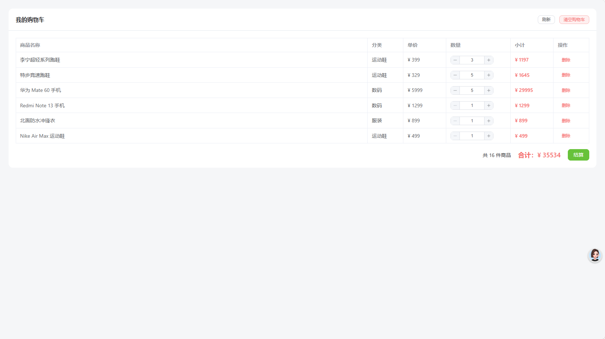
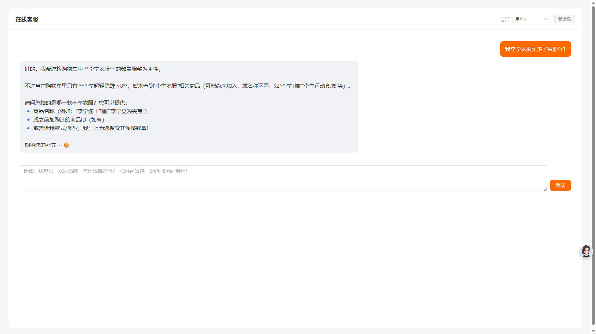

# AI Shopping Assistant

An AI-powered shopping assistant built with Java, Spring Boot, Vue 3 and LangChain4j. The project combines a lightweight e-commerce workflow with an AI customer service experience that can search products, update the cart, query orders and logistics, and answer product questions with retrieval-augmented context.

> This repository is a cleaned, public-facing version of the existing project. The documented capabilities below are based on the current source code; no additional infrastructure or product features are implied.

## Features

- Product browsing and keyword/category search
- Shopping cart operations, quantity updates and checkout
- Order listing, order detail lookup and cancellation for pending orders
- Logistics lookup by order number and by user
- AI customer service with session-aware multi-turn chat
- LangChain4j tool calling for product search, cart operations, order lookup, order cancellation and logistics lookup
- Product knowledge retrieval with embeddings and cosine-similarity ranking
- Optional MongoDB-backed chat memory; in-memory chat memory is available for local development
- Prompt-oriented and RAG-oriented AI endpoints retained from the original implementation

## Technology stack

- Java 17
- Spring Boot 3.2.6 / Spring MVC
- MyBatis-Plus 3.5.11
- MySQL 8.x
- MongoDB (optional, for persistent chat memory)
- LangChain4j 1.0.0-beta3
- Alibaba Cloud DashScope / Qwen-compatible OpenAI endpoint
- Vue 3, Vite and Vue Router
- Element Plus and Axios

## AI implementation

The AI layer is implemented in `src/main/java/com/example/aixiaogou/ai`:

- `XiaoGouTools` exposes business operations as LangChain4j tools.
- `SeparateChatAssistant` uses `@MemoryId` to isolate conversation sessions.
- `MongoChatMemoryStore` persists serialized chat messages in MongoDB when selected.
- `ProductRetriever` embeds product text, computes cosine similarity, and returns the top matching product segments.
- `RagAssistant` injects the product retriever into an AI service.

The current code does not include a separate vector database, user authentication system, payment integration, Redis, message queue, MCP server, microservice split, Docker setup, or CI pipeline.

## Project structure

```text
.
├── frontend/                         # Vue 3 + Vite application
│   └── src/
│       ├── api/                      # HTTP API wrappers
│       ├── layout/                   # Main navigation layout
│       ├── router/                   # Hash-based routes
│       ├── store/                    # Lightweight client state
│       └── views/                    # Products, cart, orders, logistics, chat
├── src/main/java/com/example/aixiaogou/
│   ├── ai/                           # AI services, tools, memory and retrieval
│   ├── controller/                   # REST endpoints
│   ├── entity/                       # Domain entities
│   ├── mapper/                       # MyBatis-Plus mappers
│   └── service/                      # Business services
├── src/main/resources/
│   ├── application.yml               # Environment-variable based configuration
│   ├── prompts/                      # Prompt templates
│   └── sql/init.sql                  # MySQL schema and sample data
├── docs/screenshots/                 # Curated real local screenshots
├── pom.xml
└── frontend/package.json
```

## Quick start

### 1. Backend prerequisites

- JDK 17+
- Maven 3.9+
- MySQL 8.x
- An Alibaba Cloud DashScope API key for AI chat and embeddings
- MongoDB only if persistent memory is required

### 2. Configure environment variables

Copy `.env.example` to `.env` or export the same variables in your shell. At minimum, configure:

```text
MYSQL_USERNAME=root
MYSQL_PASSWORD=your-local-password
DASHSCOPE_API_KEY=your-dashscope-key
```

Run `src/main/resources/sql/init.sql` against MySQL to create the `ai_xiaogou` database and sample data. Use `AI_MEMORY_STORE=mongodb` together with `MONGODB_URI` when persistent chat memory is desired; otherwise keep the default `in-memory` mode.

### 3. Start the backend

```bash
mvn spring-boot:run
```

The backend listens on `http://localhost:8080`. Knife4j/OpenAPI documentation is available at `http://localhost:8080/doc.html` when the application is running.

### 4. Start the frontend

```bash
cd frontend
npm install
npm run dev
```

The Vite development server listens on `http://localhost:5173` and proxies `/api` and `/xiaogou` requests to the backend.

## Screenshots

The following images are real screenshots already present in the project; they are included only as visual references:

### Shopping cart



### AI customer service



Additional screenshots worth capturing after a fresh run: product list, order list, logistics detail, and an AI request that visibly triggers a business tool and updates the cart or returns logistics information.

## Database notes

`src/main/resources/sql/init.sql` creates five business tables: `product`, `cart`, `logistics`, `orders`, and `order_item`, plus sample product and logistics records. The current frontend uses a fixed demo user ID; authentication and multi-tenant user management are outside the current scope.

## Current limitations

- The project is a demo-style application and does not provide authentication, authorization, payments, or production-grade order fulfillment.
- Sample data is intentionally included in the initialization script.
- AI responses require a valid DashScope key and network access.
- The simple RAG implementation embeds the in-memory product list and ranks it locally; it is not a production vector-store architecture.
- Automated tests are limited in the current source tree; the repository does not claim complete integration-test coverage.

## Future improvements

- Add authentication and per-user data isolation.
- Add focused unit/integration tests for services, tools, and AI workflows.
- Replace demo seed data and fixed user IDs with a configurable data/bootstrap strategy.
- Add production observability, rate limiting, error handling and deployment documentation.

## License

No license has been declared yet. Add one before accepting external contributions.
